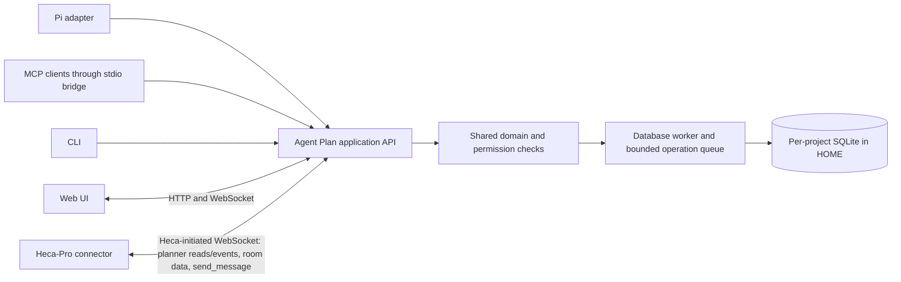

# Agent Brain architecture

Status: consolidated 2026-11-02. Product decisions live in the [decision register](decisions.md); technical contracts marked *proposed* are implementation schema until conformance evidence exists. The shared domain contract for identities, work ordering, typed results, context delivery and phase continuity is [domain-contract.md](domain-contract.md) — service/storage/recovery boundaries live in this document, business rules live there. Every agent loads its own context against the shared service; Heca initiates the collaboration channel; room policy and room chat belong to Heca and work without the planner.

## 1. Purpose and current boundary

Agent Brain extends Agent Plan's existing requirements, decisions, phase handoffs, read gates, task ownership and multi-harness tools. The first objective is reliable orientation, standards-aware work, bounded context delivery, interrupted-work recovery and truthful verification. Code intelligence extends that memory; it does not replace the planner with an unrelated agent orchestrator.

The inspected checkout is `feat/agent-brain` at `030919a7f67e275810c614e4c80a5b2a35b5d5c9`, with pre-existing uncommitted planner amendments. Current code still persists `.planner` JSON. MCP and Pi construct `PlanStore` directly. Public `/api/v1` is GET-only. This document defines the target, not a claim that those boundaries have already changed.



## 2. One application service, embedded persistence

One service per OS user manages several projects. SQLite is embedded; there is no database listener to install or administer. Only this service opens the operational database. The core exposes typed domain operations, not a general SQL or file-write endpoint.

Recommended local layout, with names subject to the final bootstrap contract:

```text
~/.agent-plan/
  runtime/server.json                 # local endpoint, service boot identity and protocol
  runtime/<version>/                  # installed service versions (Heca bundle and npm share this)
  projects/<project-id>/
    planner.sqlite                    # sole operational project authority
    backups/                          # consistent independent local backups
    transport.git/                    # optional private bare Git repository for snapshots
```

Project and workspace registrations live in their corresponding project database. The service can enumerate project stores and maintain a rebuildable discovery cache; the runtime record only advertises connection information. No additional registry database is required. Do not maintain operational JSON mirrors alongside the planner database. Cache/index lifecycle must not create competing durable truth.

Startup acquires a recoverable, user-scoped service ownership record atomically. A second launcher verifies the advertised service identity, protocol and boot epoch, then reuses it. A PID or an open port alone is insufficient proof of compatibility. Stale records lead to an explicit repair/restart path. Closing a dashboard, MCP connection or Heca window does not terminate a service used by other clients. Explicit shutdown handles outstanding operations and subscriptions.

Distribution: Heca's bundled service and npm installs both install into `runtime/<version>/`. The user-scoped launcher always starts the newest installed version; the service accepts protocol N and N-1, and MCP/Pi bridges are thin, version-tolerant clients. When a newer version is installed, the running service hands over once no write is in progress. Whichever client starts first, the result is the same service.

The driver is chosen by a T502 benchmark between `node:sqlite` and `better-sqlite3` on real planner flows, on the latest Node release available at that time; either sits behind a thin persistence-driver interface so the domain layer does not depend on it. Heca bundles that pinned Node runtime; npm installs declare it as the minimum. Both APIs are synchronous, so execute it in a worker away from Hono's network/event loop. Bound queue length, operation time, reader lifetimes and backup work. The selected SQLite build must support the required JSON and FTS functionality. Record actual runtime/build versions in diagnostics.

## 3. Identity and project discovery

Keep these identities separate:

| Identity | Meaning |
| --- | --- |
| `projectId` | Durable planner identity, unchanged by branch or folder rename. |
| Repository registration | A particular local clone associated with the project. |
| `workspaceId` | A registered source checkout/worktree; path and branch are mutable locators. |
| Planner caller | Authenticated client/session used for read context and task lifecycle. |
| Native harness session | The harness conversation/session; not a client-set alias for planner ownership. |
| `executionId` | One attributable attempt at a task, source fingerprint and evidence. |
| Heca instance/room/member | External runtime identities, namespaced by Heca server identity. |

`git rev-parse --git-common-dir` helps recognize worktrees from one clone. It is not a network identity or remote backup. Remote URLs, root commits and HEAD hashes are not universal repository IDs. A fork or copied descriptor must not silently bind an unrelated source tree to another project's live planner.

Proposed descriptor, created by the server during explicit initialization and committed through the project's normal review:

```json
{
  "schemaVersion": 1,
  "projectId": "stable-project-uuid",
  "snapshot": { "remote": "origin", "branch": "planner/export" }
}
```

Proposed name: `.agent-plan.json`. Keep credentials, local endpoints, absolute database paths and live agents out of it. For non-Git folders the descriptor still supports deliberate relocation and backup import; no remote branch is required. No personal Git hook is required after clone.

Finalized in core (T489): `packages/plan-core/src/project-descriptor.ts` — `schemaVersion` 1 with strict parsing (unknown fields fail, so no secrets or paths can ride along), the nearest-wins resolver with the repository-boundary stop, atomic writes, typed `PROJECT_DESCRIPTOR_INVALID` / `PROJECT_DESCRIPTOR_INCOMPATIBLE` errors (a foreign `schemaVersion` is never migrated silently) and the clone key derived from `git --git-common-dir` as local clone evidence only. Adapters adopt the resolver through T490's routing; until then their current inference remains the observable behavior.

Binding a folder (decided 2026-11-02): worktrees of an already registered clone (same `git --git-common-dir`) bind to the project automatically. Any other folder that carries a known `projectId` (a second clone, a copied folder, a fork) is asked once: **same project** registers it as another repository registration of that project; **new project** creates a new `projectId`, rewrites the descriptor and leaves the change for the user to commit. The answer is stored with the repository registration and is not asked again; a later rebind is an explicit action.

Every command uses the same resolver:

1. Locate the descriptor from the selected project/workspace: the nearest descriptor walking up from the working directory wins (decided 2026-11-02), so each sub-project of a monorepo has its own planner; never cross a repository boundary unless the descriptor sits there.
2. Compatible descriptor: connect to the service and resolve the registered project.
3. Incompatible descriptor: return a typed compatibility error; never fall back to `.planner`.
4. No descriptor but legacy `.planner`: offer migration with a preview and backup.
5. Neither: offer initialization. An empty folder with an undecided stack is valid.
6. Descriptor but missing HOME data: offer restore from a configured export; never create an empty substitute silently.

Explicit load activates agent context. Dashboard display and agent-context activation remain separate concerns; service bootstrap must not implicitly activate a dashboard or launch an agent.

## 4. Database responsibilities

Use relational columns for identity, ownership, parent links, state, priority and revisions. Tasks are independent rows, not elements of a phase-sized JSON document. Use JSON fields for validated extensible metadata. Store document bodies and revisions as first-class content with logical folders and stable IDs.

Recommended logical tables:

| Family | Required data |
| --- | --- |
| Planning | Project, feature, phase, task, subtask, checklist, requirement and inbox identities. |
| Relationships | Dependencies, requirement links, parent links and typed code/rationale associations. |
| Decisions | Single-owner Accepted Decisions, revisions, supersession and applicability. |
| Documents | Logical folders, document revisions, text, content hashes and required portable assets. |
| Work continuity | Phase handoffs, checkpoints, pending returns and recoverable caller focus. |
| Execution | Attempts, source/configuration fingerprints, results and target integration evidence. |
| Coordination | Caller registrations, ownership/leases, command receipts and expected revisions. |
| Context | Caller/entity/context-revision delivery records and effective-context invalidation markers. |
| History/events | Operation history, durable event cursor and transactional outbox. |
| Search | Rebuildable FTS indexes over canonical searchable content. |

Indexes support parent membership, reverse dependencies, ready work and applicable context. Foreign keys, unique constraints and schema checks protect mechanical invariants. The TypeScript domain layer owns permissions, eligibility and semantic lifecycle rules. SQLite stored procedures are not the proposed mechanism; triggers are limited to mechanical concerns such as FTS maintenance.

Graph projections, symbol indexes and provider caches are derived. They may be rebuilt and partitioned by workspace/revision without duplicating planner authority. Original source files remain in their code workspaces.

## 5. Command transaction and crash behavior

All mutation surfaces use one domain operation. Proposed request envelope:

```json
{
  "requestId": "client-generated-idempotency-key",
  "projectId": "project-uuid",
  "workspaceId": "workspace-uuid",
  "expectedRevision": 42,
  "operation": "task.start",
  "arguments": { "taskId": "task-uuid" }
}
```

The transport authenticates the principal and caller identity; client-supplied actor/role strings do not grant rights. Exact operation/path names are draft API spelling.

For a mutation, the database worker:

1. Begins a short `BEGIN IMMEDIATE` transaction.
2. Looks up the authenticated principal/project/request key. Matching retries return the stored outcome; reuse with another payload is rejected.
3. Checks expected revisions, authority, context freshness, task dependencies and current ownership.
4. Applies the mutation and structural consequences; records semantic parent/dependency reconciliation that remains pending.
5. Stores operation provenance, revisions, response receipt and event/outbox entries in the same transaction.
6. Commits, then acknowledges and publishes notifications.

Never perform Git, network, model or long provider calls inside a write transaction. Configure foreign keys, bounded busy handling and an appropriate WAL durability policy, recommended `synchronous=FULL`. A busy database yields a bounded typed retry outcome.

| Failure boundary | Required result |
| --- | --- |
| Before commit | No partial planner mutation. |
| After commit, before reply | Retry of the same request resolves the persisted outcome. |
| After commit, before event delivery | Outbox/cursor replay restores client state; duplicate events can be deduplicated. |
| Corrupt or missing database | Explicit recovery failure and backup options; no automatic empty initialization. |
| Dead client | The execution-lock lease expires when the adapter heartbeat stops (section 8); never take over a live in-progress task. |

The service must document idempotency retention. A very old retry with an expired receipt is not automatically safe to repeat. WAL is for local persistence, not a network filesystem synchronization scheme. Filesystem and hardware failure remain backup concerns.

Finalized in core (T502, benchmark 2026-11-15): `packages/plan-core/src/persistence/` (package subpath `@agent-plan/core/persistence`) — thin persistence-driver interface with typed `PERSISTENCE_BUSY` / `PERSISTENCE_CORRUPT` / `PERSISTENCE_SCHEMA_INCOMPATIBLE` / `PERSISTENCE_CONSTRAINT` outcomes, the benchmark-selected `node:sqlite` driver, versioned schema bootstrap (unknown `schemaVersion` never migrates silently), `executeCommand` with retained receipts (same payload → stored outcome; different payload → typed conflict; stale `expectedRevision` → typed revision-conflict, no mutation), transactional outbox with per-consumer cursors, documents with revision history/assets and rebuildable FTS5 search with snippets and pagination, and `VACUUM INTO` snapshot/restore primitives for T494/T495. Clients receive content through these domain operations only — never SQL or DB paths.

Finalized in core (T496): `packages/plan-core/src/persistence/reconciliation.ts` + the pure rollup ladder `src/status-rollup.ts` (ported verbatim from PlanStore's private derivation). `reconcileLeafMutation` runs inside the command transaction: reverse indexes answer old/new parents (both sides of a move), requirement links and real dependency consumers with no full-plan or full-ancestor reread; parent status is derived from rows and travels in the version-bound impact receipt (never persisted, matching the JSON store's read-time derivation); semantic prose changes create durable `reconciliation_required` obligations committed atomically with the leaf — resolution requires explicit evidence (a factual parent edit or a reviewed-unchanged record), stale/cyclic/foreign reconciliations are typed refusals, and genuine high fan-out is enumerated up to a cap (50) with a durable fan-out-continuation obligation feeding the paginated listing. A leaf save cannot claim complete reconciliation while `hasOpenObligations` still returns true.

## 6. API parity and client migration

Keep the existing v1 read contract compatible or advertise an explicit deprecation/version transition. Add a versioned complete application API; `/api/v2` is a proposed namespace, not an implemented endpoint.

| API family | Required behavior |
| --- | --- |
| Discovery/projects | Protocol, boot identity, project resolve/register, authorized project listing. |
| Planning | Full existing CRUD/discuss/checklist/move/dependency/requirement/decision coverage. |
| Lifecycle | Context preparation, start, pause, switch, complete, recovery and recommendation. |
| Documents/search | Folder navigation, bounded reads/writes, history and filtered search. |
| Handoffs | Existing prepare/write/read-back/verify/archive semantics. |
| Source/providers | Workspace access, safe saves, capability setup, code/graph queries and external open. |
| Recovery | Backup, export preview/publication, import preview/conflict resolution and restore. |
| Events | Authorized project subscriptions with consistent snapshot/cursor bootstrap. |

Maintain a parity inventory against actual MCP, Pi, CLI and Web UI operations, including errors and approval rules. MCP remains a stdio tool bridge; Pi retains its native integration. Neither constructs an independent operational store. No client receives a database path as an integration contract. User and agent callers retain distinct identities; an agent cannot impersonate a supervisor by sending a UI header. Agent planner writes are not restricted between agents: every mutation records actor and requester. Local access without a token: listen only on `127.0.0.1`, reject any `Host` header other than `localhost`/`127.0.0.1` (DNS rebinding), accept writes and WebSocket upgrades only from the Agent Plan UI and Heca origins, and never send `Access-Control-Allow-Origin: *`. There is no LAN mode. All requests pass one authentication middleware with pluggable strategies (today: loopback + Host/Origin; later: per-device tokens issued by pairing), resolve a `principalId` for audit, and get permissions from that principal, never from being local.

## 7. Search, documents, skills and context

Database search replaces `rg` on planner data. `rg` remains useful on the actual code repository. The server exposes literal/ID search, FTS word/phrase/prefix search, structured entity/feature/phase/status filters and bounded history search. FTS token matching is not regular-expression search or semantic understanding. Results contain references, field, excerpt, revision and pagination; excerpts do not satisfy a required full context read.

FTS maintenance participates in the content transaction and is rebuildable. Logical document folders replace legacy `.planner/docs` paths. Import maps every description/handoff document reference to a stable document identity, validates assets and retains provenance. Do not keep a live JSON/Markdown projection just to preserve `rg`.

An installed generic harness skill/command bootstraps discovery and explains how to call `planner-load`. Project customizations and the server-delivered operating guide provide actual text through MCP/Pi/API. A skill stored in a database does not become discoverable to a harness automatically. Inventory all generated plugin copies, pointers and hook coverage; preserve project customizations during migration.

Context preparation resolves task, phase, feature, applicable rules, requirements, decisions, code precedents and tests. It returns complete missing/stale context, with bounded continuation. Suggested record:

```text
context_reads(caller_id, entity_id, context_revision, delivered_at)
```

Record completed delivery, not an internal SQL read. A complete orchestrator read does not count as a worker read. Separate meaningful context revisions from routine activity timestamps. Reuse unchanged content only while it remains available in the effective session context. Compaction/reset requires restoration even if a persistent receipt survives.

Task start rechecks delivered revisions and current ownership transactionally. It never certifies that a model understood the material or complied with coding conventions. Before code changes, identify existing implementation precedents; after changes, record actual conformity review. Preserve the approved warning-only no-task guard unless a separate policy change is agreed.

## 8. Phase continuity, priority and consistency

Keep the current scheduling policy: owned active work and valid pending returns precede globally ready feature -> phase -> task selection. Correct the current-phase preference conflict through T462/T463; do not introduce a global task queue, free task pooling or automatic priority-based interruption. Recommendations are advisory: the orchestrator follows planner priorities and, with the user's agreement, may start a task out of order; the planner records the reason and only warns about unmet dependencies.

Heca normally coordinates coherent phase work through its room orchestrator; several workers may still own distinct tasks in that phase. Phase continuity does not mean inventing a new global exclusive phase lock.

The execution lock is the only planner block:

| State | Meaning |
| --- | --- |
| In-progress | A live session is executing the task; another session cannot start it. |
| Parked | Left by a switch or return; does not block. A takeover warns, is recorded and the original session is told when it returns. |
| Abandoned | The adapter heartbeat (about every 30 s, in code, not model turns) stopped; the lease expires about 2 min after the process dies and releases without manual recovery. |

The same logical agent (same Heca member, or same harness + workspace when standalone) reclaims its own tasks from a new conversation. A live owner idle beyond a configurable threshold (e.g. 2 h) is shown idle; another agent or the user may take it over only with explicit confirmation. The Web UI offers a human Release action.

For an approved A -> B -> C temporary detour, persist the checkpoint, reason, caller/execution, temporary target and return condition. Completion of C offers B, then A, even if a temporary phase closes. A blocked return remains visible with its reason. A return to a task taken over in the meantime reports the takeover instead of failing.

Every mutation assesses its smallest affected set: old/new parent chains, reverse dependencies and applicable context. Perform deterministic structural updates atomically. For user-authored semantic prose, record reviewed-unchanged evidence, a factual authorized update or an explicit pending obligation. Never silently rewrite architectural decisions. Source-area relationships are not scheduling dependencies.

Moving a task preserves UUID/short ID, history, checklist, execution links and dependency identities. Revalidate parent containment and affected context. Reference labels may change; permanent code/planner identity does not depend on a three-digit display field. Verify 999->1000, 9999->10000 and the supported safe-integer range.

## 9. Code intelligence, editor and AgentTest

Capability-driven provider setup works for empty folders, declared stacks, detected mixed codebases and unsupported languages. SCIP import, language servers and syntax parsing provide different operations; none is universally required or universally available. Select compatible providers from extensible metadata and verify actual results. Installation/configuration follows the project's authorization policy.

A code link separates historical source evidence, current resolved location and the review of its meaning. Anchor code to recoverable source/configuration snapshots and symbol/structure evidence. Renames, moved files, external edits and ambiguity require explicit resolution state. Track a large task through changesets and significant scoped rationale rather than manually describing each changed function.

T484-T488 own source access, revision-safe saves, shared compatible language-server processes, Monaco and external editor opening. Draft, saved and historical versions remain distinct. Shared analysis must respect workspace/build/configuration and dirty overlays; it does not imply one language server for unrelated workspaces.

AgentTest's currently supported design scope is revision-bound verification evidence: execution, command/suite, environment, result, relevant coverage and source/configuration fingerprint. A result at revision A cannot certify changed revision B. Verified work, historical merge and current target availability are separate facts. Decided 2026-11-02: in this delivery agents run tests with their own tools and the planner only records the evidence. A built-in runner or a separate autonomous test-generation/execution product is later work with its own design, permissions and budget.

Web UI sections: resume, planner, context/graph, code/editor, executions/target availability, controls and proposals. Show the project name in page titles and entity details. Heca rooms/chat/actions are additional capabilities, not requirements for standalone planning or testing evidence.

## 10. Migration and restore

Migration is a server operation with a dry run:

1. Discover all relevant legacy copies, source roots, schema versions and active old writers.
2. Create immutable, consistent full backups before changing bindings.
3. Stage entities, decisions, requirements, handoffs/archives, custom skills, documents and assets. Preserve stable IDs, counters, history and unresolved provenance.
4. Reconcile divergence using identity and available common baselines; retain every unresolved alternative. Never resolve with file mtime or whole-file ours/theirs.
5. Validate references, parent containment, dependency cycles, document/asset completeness and schema constraints. Runtime locks/PIDs/foreign ownership are not portable authority.
6. Present the report and obtain the required migration choice. Activate validated data and write the descriptor only after a durable success boundary.
7. Retire old copies as explicit read-only migration sources or recoverable backups. All supported clients must reject competing writes. A partially activated migration must resume or roll back from its durable journal.

Initial migration/restore (P130) depends only on the service foundation (T490), not on target-integration work, so the first usable recovery path is not withheld.

## 11. Backup, Git publication and snapshot conflicts

Use SQLite's consistent backup mechanism, not a simple copy of an open database file. Read the exported project revision from the actual snapshot. Configure retention and surface last successful local backup and remote publication separately. Backups inside the service data root help with local failures but are lost if that whole directory is deleted; configure an independent destination or remote export for that case.

Portable export contains versioned logical JSON, manifest, project identity/revision, baseline identity, content hashes and required document/source-evidence assets. Exclude credentials, active ownership/leases, PIDs and derived caches. Preserve historical attribution without resurrecting live sessions. Imported delivery records never grant a new caller permission to skip context.

An explicit UI/tool export-publication command may commit/push this snapshot to the configured remote branch. Use a private bare transport repository, leaving the code checkout, index and branch untouched. Import uses fetch plus staged inspection, not pull into the live database. The descriptor tells a future clone where to look; normal Agent Plan bootstrap creates local service data when requested. Do not require per-user Git hooks or a permanent user-managed worktree.

Track the last imported/published baseline as well as the observed remote tip. Before publication, fetch and compare them. A non-fast-forward push check alone cannot detect every logical replacement of newer data by an old snapshot.

Recommended first-release remote policy:

| Situation | Behavior |
| --- | --- |
| Remote unchanged from the known baseline | Publish the consistent local snapshot with a normal push. |
| Local unchanged, remote advanced | Offer validated import; retain a local backup. |
| Both changed | Stop automatic publication/import, preserve both snapshots and present reconciliation. |
| No trustworthy common baseline | Require explicit identity/baseline reconciliation; no timestamp winner. |

Proposed reconciliation compares stable entities/fields against a common exported baseline. Merge independent non-conflicting changes only after validation. Same-field edits, deletion versus edit, lifecycle conflicts and incompatible decisions remain explicit choices. Recheck parent links, cycles and counters after every resolution. Never auto-merge ownership. The exact field rules and UI remain open acceptance work.

Import stages and validates before a short activation transaction that rechecks the local revision. Keep a recovery backup; do not replace an open SQLite/WAL file underneath running connections. An interrupted Git publication checks the remote outcome before retrying; it never assumes a timeout means no push occurred.

Deleting HOME loses unexported local changes. The descriptor and the last complete remote export can rebuild the planner up to that exported revision. They cannot recreate unsaved history, credentials or unbacked-up code.

Multi-computer use is outside this delivery. If two computers are used anyway, they are independent local authorities: export/import detects divergence but gives no shared task claims, and field-level reconciliation is deferred. Never place the SQLite file on a shared drive.

## 12. Acceptance and technical references

Use isolated temporary projects and freshly packed clients. Required cases include two worktrees and several projects, startup races, context change between read/start, simultaneous claims, crash before/after commit, lost acknowledgement, event replay/gap, incomplete import, HOME loss, remote divergence, unsupported language and standalone operation without Heca.

Measure representative server flows: latency, bytes/characters, actual model tokens when available, query count and context reuse. Synthetic SQLite primitives are directional, not a product speed guarantee. Run focused checks during implementation and the canonical final gate at closeout; this documentation change requires link/consistency validation rather than runtime/database tests.

Primary technical references: [SQLite transactions](https://www.sqlite.org/lang_transaction.html), [WAL](https://www.sqlite.org/wal.html), [backup](https://www.sqlite.org/backup.html), [FTS5](https://www.sqlite.org/fts5.html), [JSON support](https://www.sqlite.org/json1.html), and the inspected [Node 25.4 SQLite API](https://nodejs.org/download/release/v25.4.0/docs/api/sqlite.html). Driver: chosen by the T502 benchmark; see the [decision register](decisions.md).
